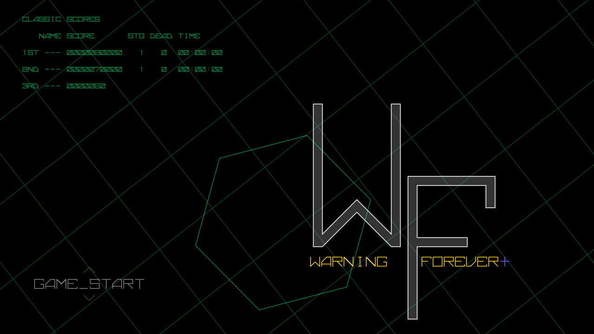
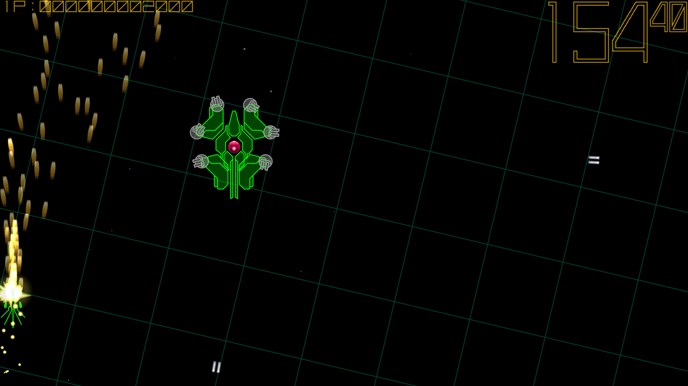
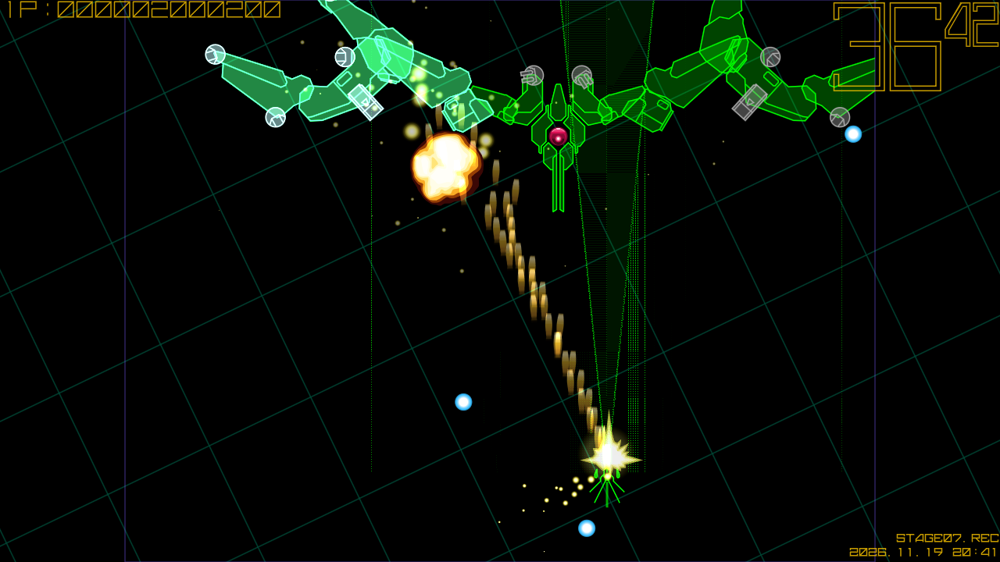
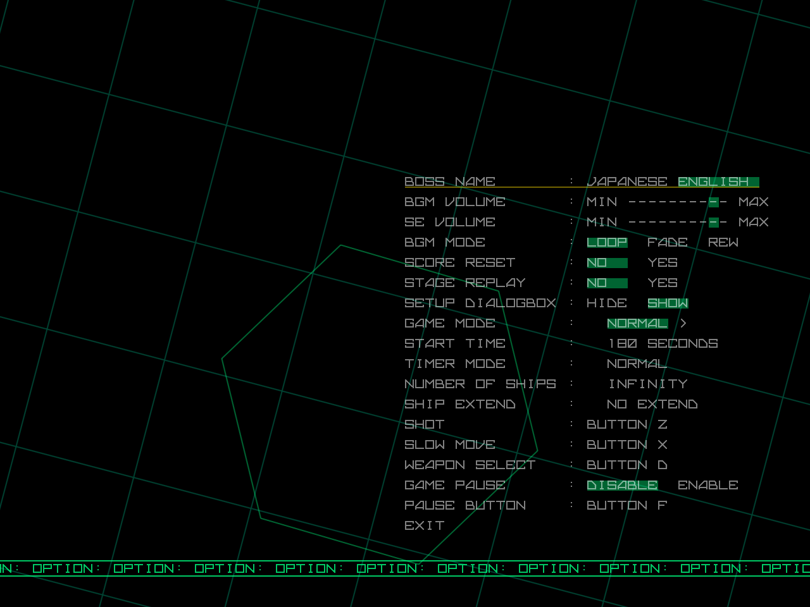
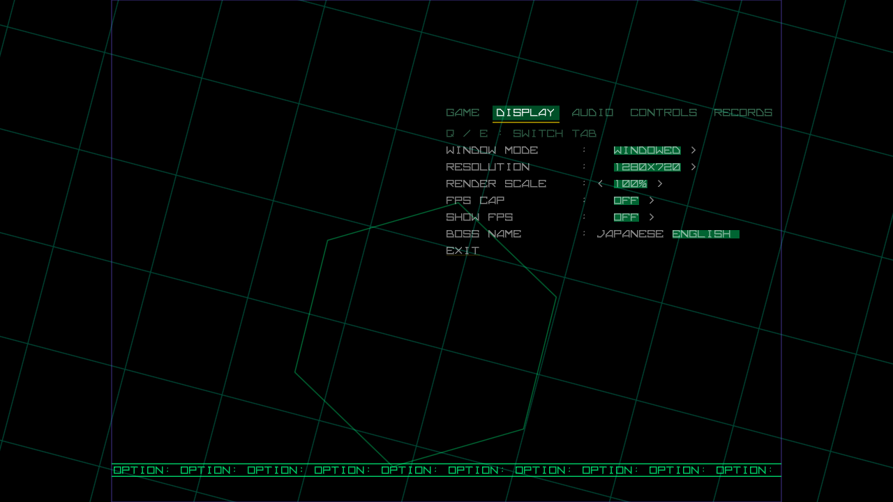
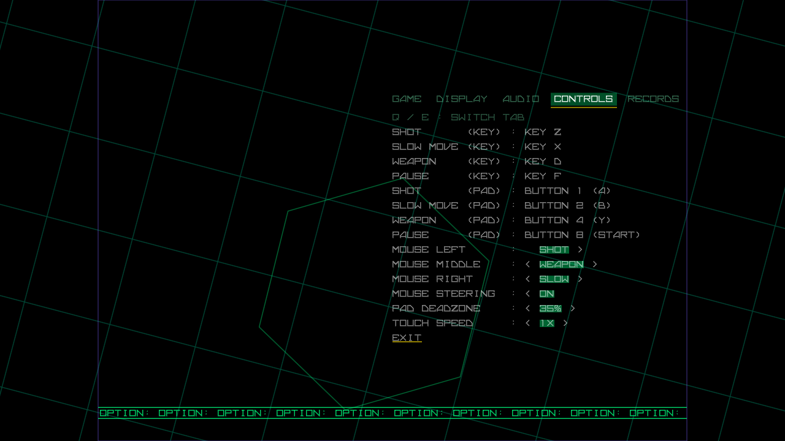
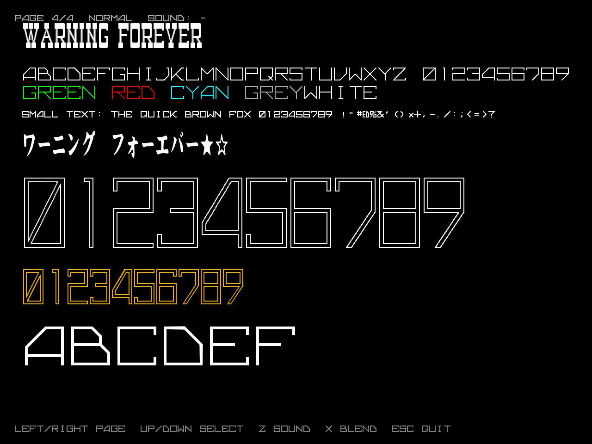
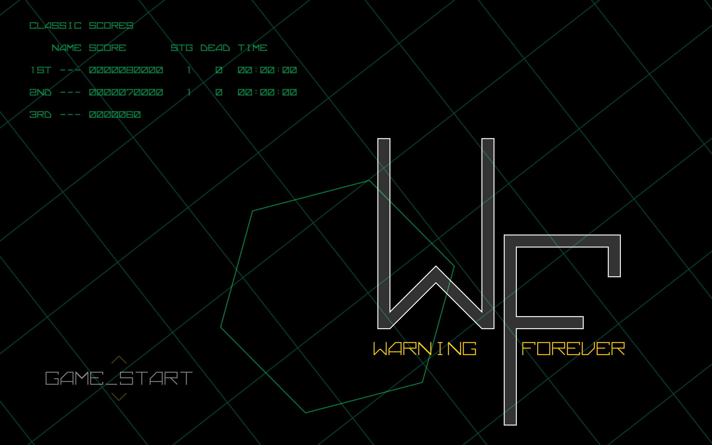
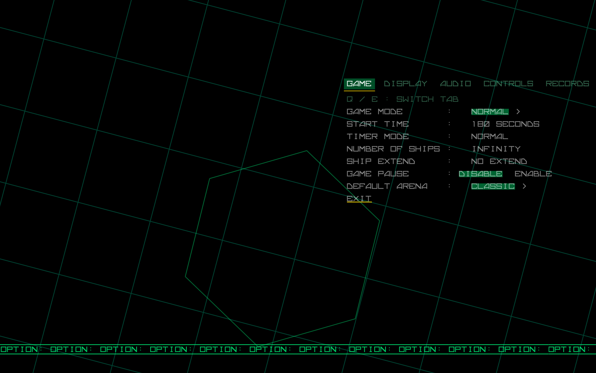
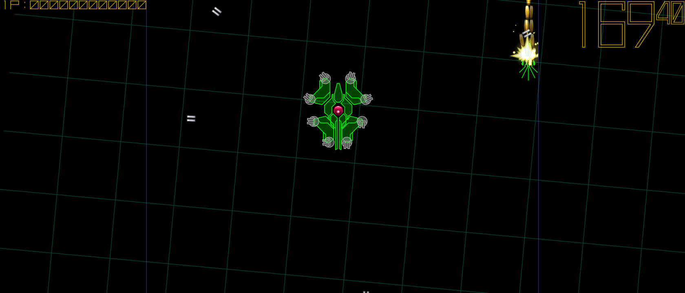

# Warning Forever+ (Warning Forever Plus)

A port of Warning Forever 1.08 (Hikoza T. Ohkubo, 2005) to Rust.

This port was completed using generative AI (Claude Opus 5.5).

> [!WARNING]
> **Disclaimer:** there is no official release of Warning Forever or Warning Forever+ on any
> storefront. The only official sources are [the original
> website](https://www.hikware.com/Prod/index.html#wf) and the
> [wf-decomp](https://github.com/okeBUDDY/wf-decomp) and
> [wf-plus](https://github.com/okeBUDDY/wf-plus) repositories on GitHub.

**Contents**

- [Overview](#overview)
  - [Screenshots](#screenshots)
- [The game data](#the-game-data)
- [Arena modes](#arena-modes)
- [Build and run](#build-and-run)
- [Controls](#controls)
- [Architecture and seams](#architecture-and-seams)
  - [Bit-exact simulation](#bit-exact-simulation)
  - [Rendering](#rendering)
- [Verification](#verification)
- [Known gaps](#known-gaps)
- [Licence](#licence)

## Overview

Warning Forever+ has its own version numbers, separate from the original's:
semantic versions starting at 1.0.0, always shown with the name, as in
"Warning Forever+ 1.0.0 (based on Warning Forever 1.08)". Every release is
based on 1.08, the original's last version.

Version 1.08 is the last release: the original developer ended development and support of the
game after it. The game is still [freely available to download from the official
website](https://www.hikware.com/Prod/index.html#wf). This repository does not contain the game;
running the port needs version 1.08's `data.bin`, from your own copy of the download: the game
finds `wf108.zip` by itself or asks for it on first run (see [The game data](#the-game-data)).

The port is 64-bit and platform independent: SDL3 for the window, input and
audio, wgpu for the GPU. The [decompilation](https://github.com/okeBUDDY/wf-decomp) of the original is
the reference for behaviour (read only, not part of this repository). No Win32, DirectX or HL-library code is
emulated: the port starts above those layers, at what the game asked of them.

The whole game is ported: title, options, the game with every boss part and
the boss generator, the HUD, game over and name entry, the score table,
replays, and the music sequencer. It plays the original's own replays back
frame-exact (see [Verification](#verification)).

The original's renderer is replaced. Warning Forever drew bitmap sprites and
1-pixel lines through Direct3D 7 at 640x480; the port draws vector versions of
that art on the GPU with a renderer built on [Eric Lengyel's Slug algorithm](https://terathon.com/blog/decade-slug.html),
which computes coverage straight from the shapes' quadratic Bézier curves in
the fragment shader. The art stays sharp at any resolution or aspect, with no
upscaling. The heaviest sprites are rasterized once per scale into a cache and
reused, and the title character is still the original pixels (see
[Rendering](#rendering)).

### Screenshots

| | |
|---|---|
|  |  |
|  |  |
|  |  |
|  |  |
|  |  |

The menus fill the window at any aspect, here 2000x1253:

| | |
|---|---|
|  |  |

The Classic arena in a 21:9 window, with its border:


The screenshots are made by `scripts/docs-screenshots.sh`.

## The game data

The original game data is not part of this repository. You need `data.bin`
from the 1.08 release (`wf108.zip`, the game's download, see above). It is
the only runtime input; `wf.exe` is never read, at run time or at build time. Constants that came from
`wf.exe` (tables, literals) are in the source as `const` tables with their
address cited.

`data.bin` is looked up in this order: `--data <path>`, `WF_DATA`, then a
`data.bin` in the working directory, the home folder (see below), next to
the executable or in the user's Downloads folder. With none of those, the
same folders are searched for the download itself, `wf108.zip` (also as a
browser renames it, `wf108 (1).zip`), newest first, and its `data.bin` is read
straight from the zip; nothing is extracted or saved. Either way the file
must be version 1.08's (its size and CRC-32 are checked).

When nothing is found, a window explains where to get the game and links
the official download page. Drop `wf108.zip` (or `data.bin`) on it and its
`data.bin` is saved to the home folder (CHOOSE WF108.ZIP opens the system file
dialog for the same); a `wf108.zip` that appears in the
searched folders meanwhile (the browser finishing the download) is used in
place, as above.

Music is `bgm.seq`, `bgm.ogg` or `bgm.wav` next to `data.bin`, as in the
original (in the home folder when the data comes from a zip).

Settings (`wf.ini`), the score table (`wf.sco`, the original's format) and
replays (`rec/*.rec`, the original's format) live in the home folder:
`--home <dir>`, else `WF_HOME`, else the working directory. The original's
own `wf.ini`, `wf.sco` and `.rec` files work as they are. The port's own
settings (display, mouse and touch, the last arena) go to `wf-plus.ini` beside
them, and HD scores to `wf-hd.sco`; `wf.ini` keeps only the
original's keys and values.

## Arena modes

After GAME START the title asks for the arena; the choice is remembered.

* **Classic** is the original's 640x480 arena, exactly: its replays and
  scores are the original's formats, byte for byte. In a window of another
  shape the arena stays 4:3 in the middle, with a faint violet border; the
  background grid runs into the margins, and the HUD (score, timer, the
  WARNING, name-entry and result bands) keeps to the window's edges. That
  is display only: the game itself never sees the window.
* **HD** is 480 high and as wide as the window's shape (clamped to
  270..1920). Every screen-derived value (player and boss bounds, spawn and
  aim points, culling, the grid, the HUD's anchors) comes from the arena in
  one place (`game/arena.rs`). The arena is locked when the game starts and
  stored in the recording (version 1103, which the original refuses), so
  replays and resizes keep it, letter- or pillarboxed. HD scores have
  their own table with each entry's arena size.

## Build and run

```
cargo build --release
target/release/wfplus --data path/to/data.bin
```

SDL3 is built from source (`sdl3` crate, static), which needs CMake and a C
compiler; on Linux also the X11/Wayland/PulseAudio development headers.

The executable is `wfplus` (`wf+.exe` on Windows). `scripts/build-windows.sh`
cross-builds the Windows release from Linux (rustup target
`x86_64-pc-windows-gnu`, mingw-w64): a static `wf+.exe` with its icon,
version resource and manifest, zipped on its own: the release carries none of
the original game's files, whose licence allows public redistribution only
with the author's permission. `--with-data` adds data.bin and the original
readmes, for a build of your own.

`android/` is the Gradle project for Android (arm64-v8a and x86_64,
Android 7 and later); it builds the same crate as `libwfplus.so` through
cargo-ndk. `gradle assembleRelease` makes the APK to sideload, signed with
the key that `-PWF_SIGNING=signing.properties` names (`storeFile`,
`storePassword`, `keyAlias`, `keyPassword`; kept outside the repository, and
the same key for every release so that updates install over each other).
`-PWF_DATA=path/to/data.bin` bundles data.bin and the readmes, for a build
of your own.

Building needs the art, which `crates/wf/build.rs` cooks into the
executable. It is in [`assets/1.08`](assets/1.08): the vector art redrawn
from version 1.08's sprites and fonts, and the one original image the build
still reads, the title character (see its README). Overrides:

| Variable | What |
|---|---|
| `WF_ART_DIR` | The vector art, `<sheet>/<sheet>_<id>.svg`. |
| `WF_BITMAP_DIR` | The cut sprites, for the art that stays a bitmap (the title character). |
| `WF_GLYPH_DIR`, `WF_GLYPH_PATTERNS`, `WF_GLYPH_CSV` | Where the vector glyph SVGs are and how they are named (`;`-separated patterns using `{font}`, `{index}`, `{sheet}`, `{x}`, `{y}`, `{csv}`). |

Options:

| | |
|---|---|
| `--size WxH` | Window size (default 1280x720, resizable; the arena is fitted and centred). |
| `--arena classic\|hd` | The arena of new games (else the last choice). |
| `--fps-cap off\|vsync\|N` | Frame cap (default off: uncapped, interpolated). |
| `--fullscreen`, `--borderless`, `--windowed` | Window mode. |
| `--render-scale K` | Render at K times the window's pixels, then stretch. |
| `--show-fps` | Show the frame rate. |
| `--caps desktop\|android` | Show the options as on another platform (Android omits WINDOW MODE and RESOLUTION). |
| `--bench SECONDS` | With `--headless`: measure the uncapped frame rate offscreen. |
| `--replay rec/<file>.rec` | Play a replay (relative to the home folder). |
| `--headless` | No window and no audio device: run frames as fast as possible. |
| `--frames N --screenshot out.png` | Stop after frame N and save it. |
| `--script FRAME[-LAST]:KEY,...` | Hold keys over frames (up, down, left, right, z, x, d, f, q, e, pageup, pagedown, esc, f12). |
| `--hash-log out.txt` | Write a hash of the game state after every game frame (desync hunting). |
| `--viewer` | The art and sound viewer instead of the game. |
| `WF_LOG=error\|warn\|info\|debug` | Log level (stage results, game over, file errors). |

## Controls

Input is action based: every device makes the same actions, and the game
reduces them each tick to the original's eight directions and eight
triggers, which is all a `.rec` stores. Devices work side by side, and the
last one used picks the prompts.

* Keyboard: arrows (or numpad) move; Z shoots, X moves slowly, D selects the
  weapon, F pauses (when enabled). Esc quits, F12 resets to the title.
* Mouse: the ship steers toward the pointer; left shoots, right moves
  slowly, middle selects the weapon (all rebindable). In play, a turn of
  the wheel also selects the weapon, and the back button (X1) resets to
  the title.
* Gamepad (SDL_Gamepad, hot-plugged): left stick or d-pad, with a dead zone;
  buttons are triggers. A gamepad touchpad drags the ship.
* Touch: drag anywhere to move the ship relative to the finger; a finger
  down shoots. A second finger anywhere moves slowly while it is held, and
  a quick tap of it selects the weapon. Android's Back resets to the title
  from a game (and quits from the title).

The options screen is a tab strip (GAME, DISPLAY, AUDIO, CONTROLS,
RECORDS): Q/E, PageUp/PageDown, the shoulder buttons, a click or the wheel
over the strip, or a sideways swipe change tabs. Keys and pad buttons are
remapped separately there, along with the mouse buttons, mouse steering,
the pad dead zone and the touch speed; the display settings (window mode,
resolution, render scale, FPS cap, show FPS) apply at once.

Every menu also works with the mouse alone, and the same targets take
taps. On the title, hover and click the item to choose it and the arrows
above and below it (or the wheel, or a vertical swipe) to step through the
items and the arenas; `< BACK` and the right button leave the arena
choice, and clicking the score heading switches the Classic and HD tables.
On the options screen, hovering picks a row; a click steps a value forward
on its right half or `>` and back on its left half or `<`, the right
button steps it back, and the wheel steps the value under the pointer (or
moves the cursor elsewhere). EXIT ends every tab. A click or tap resumes a
pause, the name entry takes a click on a letter, the wheel and the right
button (delete). The mouse's back button (X1) cancels everywhere (on the
title menu, like the right button, it moves to EXIT).

## Architecture and seams

| Crate | |
|---|---|
| `crates/wf-art` | The cooked art format: a GPU half (texture images uploaded as they are) and a CPU half (the sprite table). |
| `crates/wf-cook` | The build-time cooker: SVG art to Slug curves and bands, the vector glyphs, the bitmap atlas, the baked feTurbulence lattice. |
| `crates/wf-engine` | The engine: app loop, time, renderer, layout, input, audio mixer, config, asset registry, platform (SDL3). |
| `crates/wf` | The game: deterministic state that emits a draw list each tick. |

The engine owns the loop. The game advances in fixed 17 ms ticks from an
accumulator (at most 8 per frame), exactly in the original's order and float
order; the display runs uncapped by default (Mailbox or Immediate present)
or capped (VSync on Fifo, or 60/120/144/240/custom by a sleep-then-spin
limiter), and draws between the last two ticks' snapshots with alpha
interpolation. Interpolation only reads the snapshots: draws are matched
by key, and snap across teleports, wraps, flips and sharp turns. A
`Layout` fits the arena into the window (DPI-aware, render scale by an
offscreen target), with background draws over the whole window and arena
draws scissored to the arena. Instances go through a persistent three-deep
ring buffer.

| Engine module | |
|---|---|
| `app.rs` | The `Game` trait, the windowed loop, headless ticks and the bench, the arena border. |
| `time.rs` | `FixedStep`, `FpsCap`, `Limiter`, `FpsCounter`. |
| `gfx/` | `DrawList` (the snapshot), `Layout`, interpolation, the wgpu Slug renderer (`gpu.rs`, `slug.wgsl`), the render-scale blit (`scale.rs`). |
| `input.rs` | Actions, bindings (`wf-plus.ini`), and the device providers. |
| `platform/` | **Seam**: `RawInput` (keys, gamepads, mouse, fingers, last device), events, window modes and icon; `sdl.rs` is the SDL3 backend. |
| `audio/` | The software mixer the audio callback pulls from. |
| `assets.rs` | The asset registry over mounted sources (data.bin, directories). |
| `config.rs` | `wf-plus.ini`, display settings. |
| `log.rs` | **Seam**: logging (`WF_LOG`). |

Inside `crates/wf/src`:

| Module | |
|---|---|
| `game/` | The port, file by file from the decompilation: `app.rs` (Application::Run), `task.rs` (task lists), the stages `fn_title.rs`, `fn_game.rs`, `fn_option.rs`, `hud.rs` (game HUD, game over, name entry, results), `actor/` (actor system and every control), `enm/` (boss generator), `replay.rs`, `records.rs`, `score_table.rs`, `profile.rs` (portable ini), `math.rs` (the f32/x87 maths), `debug.rs` (state hash); and the port's own `arena.rs` (arena modes), `settings.rs` (`wf-plus.ini` settings, menu input), `input.rs` (actions to the original's input bits). |
| `data/` | data.bin and the .pat pattern files. |
| `main.rs` | The command line, and `WfGame`, the game as the engine drives it. |

Icons are in `assets/icon` (the window icon, and the exe's on Windows).

### Bit-exact simulation

The simulation keeps the original's float behaviour: f32 maths in the
decompilation's operation order, no fused multiply-add, transcendentals as
`(x as f64).fn() as f32` with `fn` from the pure-Rust `libm` crate (the same
bits on every platform), `_ftol` truncation, and the C runtime's `rand()`.
The sine table is baked from the x87's FSIN and checked against the x87 (with
24-bit precision control) by `game/x87_tests.rs` on x86-64, along with
libm's `sin`, `cos` and `atan2` over sweeps, and `sqrt`.

### Rendering

Art is drawn with the [Slug algorithm](https://terathon.com/blog/decade-slug.html) (Lengyel, JCGT 2017). The cooker turns
each SVG path into quadratic curves and builds horizontal and vertical bands
per layer; the fragment shader casts a ray along each axis and turns the
crossings into coverage. Layers are painted (solid, linear or radial ramp,
the sys0_008 combined ramps, and add0_027's SVG `feTurbulence` fractal noise,
evaluated on the spec's lattice, which the cooker bakes per seed) and
composed in the shader, then blended once, normal or additive, in gamma space
as on the original's Direct3D 7. Untextured shapes go through Slug too. The
constant point tables (`gfx/shape_table.rs`, addresses cited) are cooked as
sprites `shape/<name>` in local coordinates, transformed per instance on the
GPU like any sprite. Lines are stroke layers: each edge is stored as centre
points plus unit normals, and the shader offsets them by half a pixel under
the instance's transform, so lines stay one pixel wide at any scale, as
Direct3D 7's did. Shapes whose points come from game logic (lasers, the game
over chart, the options' bars) are rebuilt on the CPU into a small dynamic
region of the textures, only when their points change. Glyphs come from vector SVGs;
a glyph with none (the font sheets' empty cells) is blank. The title character
stays the original pixels in a bitmap atlas, drawn with sharp-bilinear
sampling.

Two fast paths keep heavy scenes cheap without changing the image much. The
sprite cache (`gfx/cache.rs`) rasterizes a sprite's whole layer stack with Slug
once per scale step (1.25x) into an atlas, then draws it as a textured quad;
strokes are never cached. Line shapes and small fills (`gfx/lines.rs`,
`gfx/fills.rs`) skip Slug's bands and compute their coverage analytically on
thin quads. Both are on by default; `sprite_cache = off` or
`analytic_shapes = off` under `[gfx]` in `wf-plus.ini` turns them off.

## Verification

* `cargo test --workspace` runs the unit tests (score table, profile,
  sequencer, WAV, turbulence lattice, and the x87 checks), and
  `cargo clippy --workspace --all-targets` is clean.
* `scripts/playtest.sh [recordings] [data.bin]` plays every `stageNN.rec` of
  every recording made with the original game, headless. It checks that each
  stage ends on the score the next stage's recording starts with, and that
  the last ends on the score in that run's `wf.sco`. All 24 stages of the six
  recordings match: normal, 3 ships, 5-minute attack and sudden death,
  including a 19,085-frame stage with pauses.
* `--hash-log` gives identical files across runs of the same replay.
* `scripts/hd-determinism.sh [data.bin]` records an HD game in
  4:3, 16:9, 21:9 and portrait windows and replays each at its own size and
  another: the hash logs match and each replay ends on the live result.
* Uncapped frame rate, headless and offscreen (`--bench 5`), on this
  project's CI container (lavapipe, a 4-core CPU rasterizer, so it measures
  pixel fill): 5 fps at 1280x720 and 71 fps at 320x180. A GPU is far faster.

## Known gaps

* Vector glyphs depend on the glyph SVG set; a missing one is blank, and
  an unreadable one is blank with a build warning.
* The kana glyphs (the Japanese boss names, BOSS NAME in the options) did
  not vectorize well and are still a work in progress, at low priority.
* As in 1.08, a game over whose score does not rank fades straight to the
  title, and `best.rec` is never written.

## Licence

There is no licence for this repository. Warning Forever+ is a port of the
code and art of Warning Forever (© Hikoza T. Ohkubo, Hikware), made from an
unofficial decompilation, so it is not ours to license: all rights stay with
their respective owners. The art in [`assets/1.08`](assets/1.08) is redrawn
from, or copied out of, version 1.08.

The third-party software the builds contain (SDL3, wgpu and the other Rust
crates) is under its own licences, collected in
[`licenses/THIRD-PARTY-LICENSES.txt`](licenses/THIRD-PARTY-LICENSES.txt)
(`scripts/licenses.sh` regenerates it) and shipped with every build.
